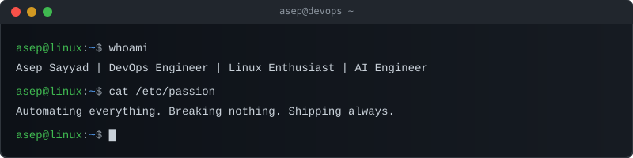

<!-- Terminal Header -->
<p align="center">
  
</p>

```
┌──────────────────────────────────────────────────────────────────────────────┐
│                                                                              │
│     ░█▀▀░█░█░█▀▀░▀█▀░█▀▀░█▄█░░░█▀█░█▀▄░█▄█░▀█▀░█▀█                       │
│     ░▀▀█░░█░░▀▀█░░█░░█▀▀░█░█░░░█▀█░█░█░█░█░░█░░█░█                       │
│     ░▀▀▀░░▀░░▀▀▀░░▀░░▀▀▀░▀░▀░░░▀░▀░▀▀░░▀░▀░▀▀▀░▀░▀                       │
│                                                                              │
│              ╔═══════════════════════════════════════╗                        │
│              ║   Asep Sayyad | DevOps Engineer       ║                        │
│              ║   "Infrastructure as Code, not Chaos" ║                        │
│              ╚═══════════════════════════════════════╝                        │
│                                                                              │
└──────────────────────────────────────────────────────────────────────────────┘
```

<!-- ASCII Profile Art -->
```
                        ████████████████████████
                    ████░░░░░░░░░░░░░░░░░░░░░░████
                  ██░░░░░░░░░░░░░░░░░░░░░░░░░░░░░░██
                ██░░░░░░░░░░░░░░░░░░░░░░░░░░░░░░░░░░██
              ██░░░░░░░░░░██████████████░░░░░░░░░░░░░░██
              ██░░░░░░░░██▓▓▓▓▓▓▓▓▓▓▓▓██░░░░░░░░░░░░██
            ██░░░░░░░░██▓▓▓▓▓▓▓▓▓▓▓▓▓▓▓▓██░░░░░░░░░░░░██
            ██░░░░░░░░██▓▓▓▓████▓▓████▓▓▓▓██░░░░░░░░░░░░██
            ██░░░░░░░░██▓▓██░░░░██░░░░██▓▓██░░░░░░░░░░░░██
            ██░░░░░░░░██▓▓▓▓▓▓▓▓▓▓▓▓▓▓▓▓██░░░░░░░░░░░░██
            ██░░░░░░░░░░██▓▓▓▓████▓▓▓▓██░░░░░░░░░░░░░░██
              ██░░░░░░░░░░██████████████░░░░░░░░░░░░░░██
              ██░░░░░░░░░░░░░░░░░░░░░░░░░░░░░░░░░░░░██
                ██░░░░░░░░░░░░░░░░░░░░░░░░░░░░░░░░██
                  ██░░░░░░░░████████████░░░░░░░░██
                    ████░░░░░░░░░░░░░░░░░░░░████
                        ████████████████████
             ┌─────────────────────────────────────────┐
             │   > Asep Sayyad                         │
             │   > DevOps Engineer & Linux Specialist  │
             │   > Location: Planet Earth (SSH'd in)   │
             └─────────────────────────────────────────┘
```

---

<!-- Interactive Terminal Session -->

## `$ ./about_me.sh`

```bash
#!/bin/bash
# ━━━━━━━━━━━━━━━━━━━━━━━━━━━━━━━━━━━━━━━━━━━━━━━━━━━━━
# SYSTEM INFORMATION
# ━━━━━━━━━━━━━━━━━━━━━━━━━━━━━━━━━━━━━━━━━━━━━━━━━━━━━

HOSTNAME="asep-sayyad"
ROLE="DevOps Engineer"
OS="Linux (btw, I use Arch)"
UPTIME="Always Online"
SHELL="/bin/zsh"
EDITOR="vim"
MOTTO="Automate. Deploy. Repeat."

echo "Welcome to my terminal. Stay a while."
```

---

<details>
<summary>📂 <code>$ ls -la ./tech_stack/</code></summary>

<br>

```
drwxr-xr-x  asep asep  4096  Jul 12  .
drwxr-xr-x  asep asep  4096  Jul 12  ..
-rwxr-xr-x  asep asep  ████  Jul 12  linux.sh
-rwxr-xr-x  asep asep  ████  Jul 12  docker.yml
-rwxr-xr-x  asep asep  ████  Jul 12  kubernetes.yaml
-rwxr-xr-x  asep asep  ████  Jul 12  terraform.tf
-rwxr-xr-x  asep asep  ████  Jul 12  ansible.yml
-rwxr-xr-x  asep asep  ████  Jul 12  jenkins.groovy
-rwxr-xr-x  asep asep  ████  Jul 12  github-actions.yml
-rwxr-xr-x  asep asep  ████  Jul 12  aws.conf
-rwxr-xr-x  asep asep  ████  Jul 12  nginx.conf
-rwxr-xr-x  asep asep  ████  Jul 12  prometheus.yml
-rwxr-xr-x  asep asep  ████  Jul 12  grafana.json
-rwxr-xr-x  asep asep  ████  Jul 12  bash.sh
-rwxr-xr-x  asep asep  ████  Jul 12  python.py
-rwxr-xr-x  asep asep  ████  Jul 12  git.config
```

### Skill Proficiency

```
Linux Administration  ████████████████████░░  90%
Docker & Containers   ███████████████████░░░  85%
Kubernetes            ██████████████████░░░░  80%
CI/CD Pipelines       ███████████████████░░░  85%
Terraform / IaC       █████████████████░░░░░  75%
Cloud (AWS)           ██████████████████░░░░  80%
Monitoring & Logging  ███████████████████░░░  85%
Networking            ████████████████░░░░░░  70%
Scripting (Bash/Py)   ████████████████████░░  90%
Git & Version Control ████████████████████░░  90%
```

</details>

---

<details>
<summary>🔧 <code>$ cat /proc/projects</code></summary>

<br>

```
PID   NAME                    STATUS      PORT    DESCRIPTION
───── ─────────────────────── ─────────── ─────── ────────────────────────────────
001   bootstrapx007.online    RUNNING     443     Personal Website & Portfolio
002   airodrop                RUNNING     443     Airodrop Platform
003   infra-automation        RUNNING     ---     Infrastructure as Code configs
004   dotfiles                RUNNING     ---     My Linux rice & configs
```

| Project | Link |
|---------|------|
| 🌐 Portfolio | [bootstrapx007.online](https://bootstrapx007.online/) |
| 🪂 Airodrop | [airodrop.bootstrapx007.online](https://airodrop.bootstrapx007.online/) |

</details>

---

<details>
<summary>📊 <code>$ neofetch --stats</code></summary>

<br>

<p align="center">
  
</p>

<p align="center">
  
</p>

<p align="center">
  
</p>

</details>

---

<details>
<summary>🐍 <code>$ cat /var/log/contributions.log</code></summary>

<br>

<p align="center">
  
</p>

</details>

---

<details>
<summary>📡 <code>$ curl --connect</code></summary>

<br>

```
┌──────────────────────────────────────────────────────┐
│  ESTABLISHING SECURE CONNECTION...                   │
│                                                      │
│  ╔══════════════════════════════════════════════╗     │
│  ║  🌐  Website   : bootstrapx007.online       ║     │
│  ║  🪂  Airodrop  : airodrop.bootstrapx007.online ║  │
│  ║  💼  LinkedIn  : linkedin.com/in/asepsayyad ║     │
│  ║  📧  Email     : asepsayyad007@gmail.com    ║     │
│  ║  🐙  GitHub    : github.com/asepsayyad007   ║     │
│  ╚══════════════════════════════════════════════╝     │
│                                                      │
│  CONNECTION ESTABLISHED ✓                            │
└──────────────────────────────────────────────────────┘
```

<p align="center">
  <a href="https://bootstrapx007.online/"></a>
  <a href="https://airodrop.bootstrapx007.online/"></a>
  <a href="https://www.linkedin.com/in/asepsayyad/"></a>
  <a href="mailto:asepsayyad007@gmail.com"></a>
</p>

</details>

---

<!-- Activity Graph -->
<p align="center">
  
</p>

---

```
┌──────────────────────────────────────────────────────────────────────────────┐
│                                                                              │
│   $ echo "Thanks for visiting!"                                              │
│   Thanks for visiting!                                                       │
│                                                                              │
│   $ uptime                                                                   │
│   up since forever, load average: coffee, code, deploy                       │
│                                                                              │
│   $ fortune | cowsay                                                         │
│    ________________________________________                                  │
│   / The best way to predict the future is  \                                 │
│   \ to automate it.                        /                                 │
│    ----------------------------------------                                  │
│           \   ^__^                                                            │
│            \  (oo)\_______                                                    │
│               (__)\       )\/\                                                │
│                   ||----w |                                                   │
│                   ||     ||                                                   │
│                                                                              │
│   [visitor@asep-github ~]$ exit                                              │
│   Connection to asepsayyad007.github.io closed.                              │
│                                                                              │
└──────────────────────────────────────────────────────────────────────────────┘
```

<p align="center">
  
</p>
